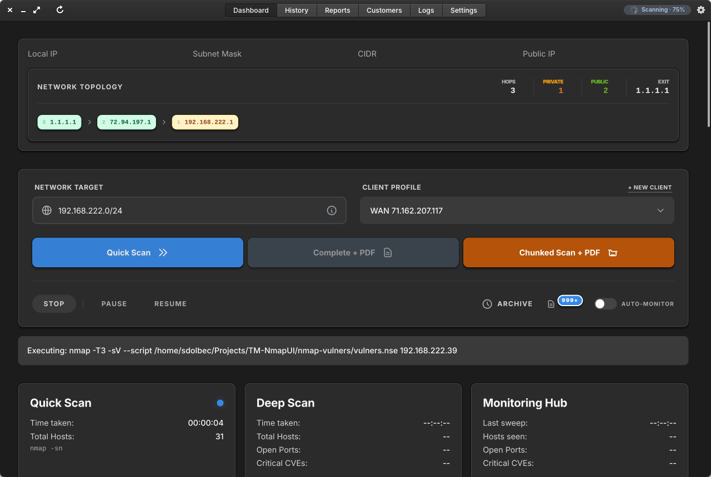
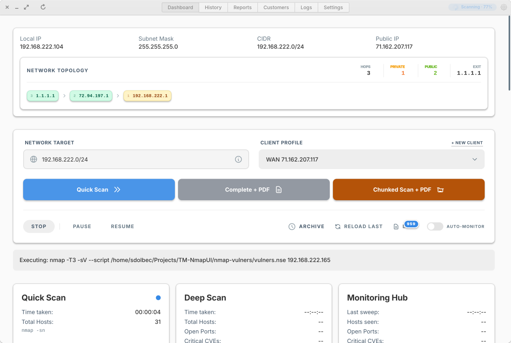
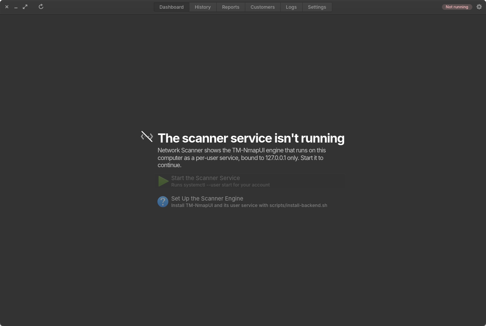
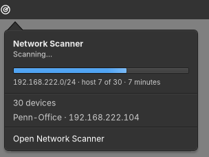
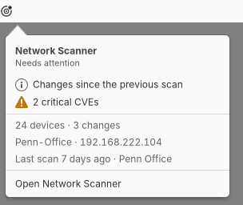

# Network Scanner for elementary OS

The native elementary OS front end for [TM-NmapUI](https://github.com/techmore/TM-NmapUI):
a Granite / GTK 4 window, a Wingpanel indicator and a per-user scanner service.



<p>
  
  
</p>
<p>
  
  
</p>

| Piece | What it is |
|---|---|
| `src/` | **Network Scanner** (`io.github.techmore.NmapUI`), a Vala app. Pantheon headerbar with segmented tabs, a live status chip, system light/dark, scan-finished notifications, report download toasts, and a Granite placeholder that starts the service when it is down. |
| `indicator/` | Wingpanel indicator: scan state and progress, network facts, hosts/changes/critical, alerts, and the device list from the latest scan. |
| `helper/nmapui-summary` | One-shot JSON summary of the local scanner (loopback API only) used by the indicator. |
| `data/` | Desktop entry, AppStream metadata, icons and the `nmapui.service` user-unit template. |
| `scripts/` | `install.sh` (build + install the app and indicator), `install-backend.sh` (clone the engine, create its venv, install the service), `snapshot.sh` (headless renders for review). |

The scanner engine itself is not in this repository. It is the Flask application on
TM-NmapUI's `main` branch, running on this computer as `nmapui.service`, bound to `127.0.0.1:9000`.
This app never implements a second scanning engine; it gives the existing one a native home.

## Install

On elementary OS 9 (Tanit), which ships GTK 4 Wingpanel (`wingpanel-9`) and WebKitGTK 6.0:

```bash
git clone https://github.com/techmore/TM-NmapUI-elementary.git
cd TM-NmapUI-elementary
scripts/install.sh
```

That builds and installs the app into `~/.local`, installs the Wingpanel indicator
system-wide (sudo), pins **Network Scanner** to the dock, and runs `scripts/install-backend.sh`,
which clones TM-NmapUI into `~/.local/share/nmapui/app`, creates its virtual environment,
installs Chromium for PDF reports, and enables the loopback-only user service.

- `scripts/install.sh --no-indicator` skips the Wingpanel module; `--no-backend` skips the engine.
- `NMAPUI_APP_DIR=~/Projects/TM-NmapUI scripts/install-backend.sh` runs the service from an existing checkout.
- `NMAPUI_REF=<branch|tag|sha> scripts/install-backend.sh` pins the engine revision.
- The indicator loads at the next login; the installer never restarts Wingpanel.
- Unprivileged scans use connect mode. SYN/OS/ARP scans need TM-NmapUI's root service
  (`packaging/ubuntu/install-service.sh`); nothing here grants raw-socket capabilities.

Data stays private under `~/.local/share/nmapui` (engine) and `~/.local/share/nmapui-elementary`
(web session and cookies). Remove everything with:

```bash
systemctl --user disable --now nmapui.service
rm -rf ~/.config/systemd/user/nmapui.service ~/.local/share/nmapui ~/.local/share/nmapui-elementary ~/.cache/nmapui-elementary
```

## Build from source

```bash
sudo apt install meson ninja-build valac pkg-config libgtk-4-dev libgranite-7-dev \
  libwebkitgtk-6.0-dev libsoup-3.0-dev libjson-glib-dev libwingpanel-9-dev
meson setup build --prefix="$HOME/.local"
meson compile -C build
meson install -C build
```

`-Dindicator=false` leaves out the Wingpanel module. Run the app from the build tree with
`build/io.github.techmore.NmapUI`. Environment variables:

| Variable | Default | Purpose |
|---|---|---|
| `NMAPUI_URL` | `http://127.0.0.1:9000` | Engine origin |
| `NMAPUI_SERVICE` | `nmapui.service` | systemd user unit the app starts and restarts |
| `NMAPUI_DEVTOOLS` | unset | Any value enables the WebKit inspector |
| `NMAPUI_SNAPSHOT` | unset | Write a PNG of the window after `NMAPUI_SNAPSHOT_DELAY` ms and quit |
| `NMAPUI_FORCE_DARK` | unset | `1`/`0` overrides the system color scheme (for renders) |

## Keyboard

| Shortcut | Action |
|---|---|
| Ctrl+1 … Ctrl+6 | Dashboard, History, Reports, Customers, Logs, Settings |
| Ctrl+R, F5 | Reload |
| Ctrl+Shift+O | Open in the default browser |
| Ctrl+Plus / Ctrl+Minus / Ctrl+0 | Zoom |
| Ctrl+Q | Quit |

## Verify

```bash
python3 -m pytest -q tests                      # summary helper
meson test -C build --print-errorlogs          # native navigation/OAuth policy
indicator/probe/run-probe.sh build/indicator out # indicator renders for four states (Xvfb)
scripts/snapshot.sh build out                    # window renders, light and dark (Xvfb)
desktop-file-validate build/data/io.github.techmore.NmapUI.desktop
appstreamcli validate --no-net build/data/io.github.techmore.NmapUI.metainfo.xml
```

CI requires both the app and Wingpanel 9 module in the
`ghcr.io/elementary/docker:tanit-unstable` container. This is the current validation
baseline; it is not a completed test on a stable physical elementary OS desktop.
CI also starts the shared engine pinned to
`632e40ddd17db262fda018c2e6c59aa6ff2d5025` on an isolated loopback port with temporary
data and profile directories, network fingerprinting, startup traceroute, Vulners
and automatic update checks disabled. It checks readiness and no active jobs,
renders the online dashboard in light and dark modes, then sends the native
Ctrl+3 action and checks the rendered Reports page with OCR. It never starts a scan.
Screenshots, OCR text, readiness evidence and the engine revision are CI artifacts.
The Docker runner alone disables WebKit's sandbox for these isolated render jobs
because it denies nested namespaces; installed application behavior keeps the
WebKit sandbox enabled.

The helper keeps unavailable scanner activity distinct from idle, preserves
paused/pausing state, bounds API response sizes and fetches independent summaries
concurrently. Wi-Fi status reads use NetworkManager's cached access-point list
without requesting a rescan. Failed summary reads clear outdated dropdown facts.

Google Drive authorization opens in the system browser, including when the web
UI first reserves an `about:blank` popup before receiving the authorization URL.
Only the exact Google authorization endpoint with the engine's callback,
`drive.file` scope and PKCE flow is handed off automatically. Other automatic
cross-origin navigation is blocked; explicit ordinary web links open externally.
This follows [Google's OAuth browser policy](https://developers.google.com/identity/protocols/oauth2/policies#use-secure-browsers).
It does not establish Google project verification or real account-consent
acceptance; those remain deployment checks.

## How it fits with the other repositories

- **TM-NmapUI `main`** is the web product and the shared scanner engine (Flask, Socket.IO, reports).
  Its `static/css/elementary.css` theme is what this window shows; the native headerbar replaces the
  page's own header and tab strip.
- **TM-NmapUI `swift-native`** is the native macOS app.
- **tm-daedalus** packages the same engine as a frozen source bundle for managed scanners and talks
  to it through a loopback bridge. The elementary app and Daedalus can share one engine install on a
  machine only if they agree on the port; by default both use 9000.
